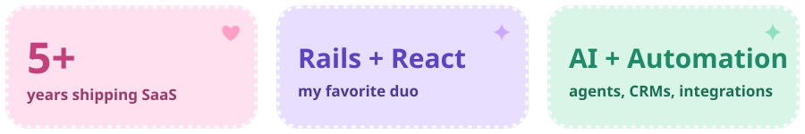
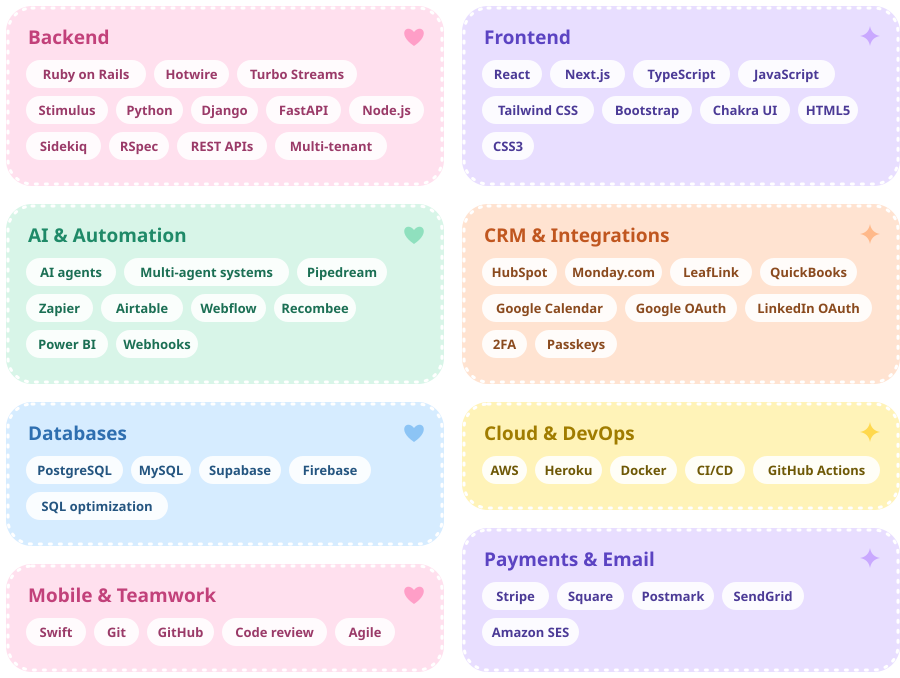
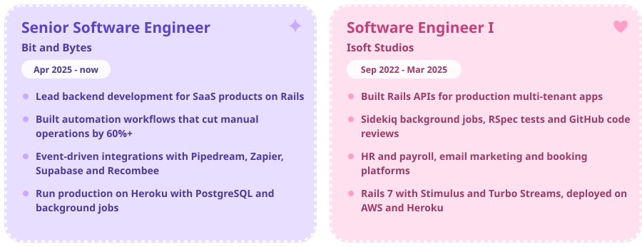
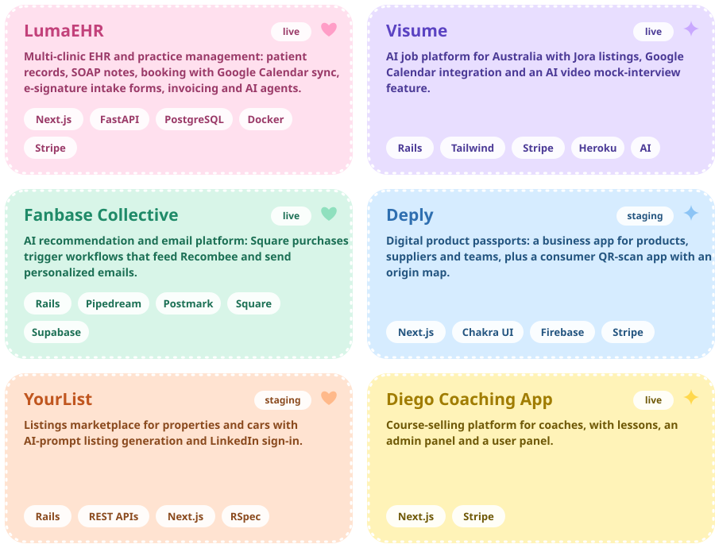
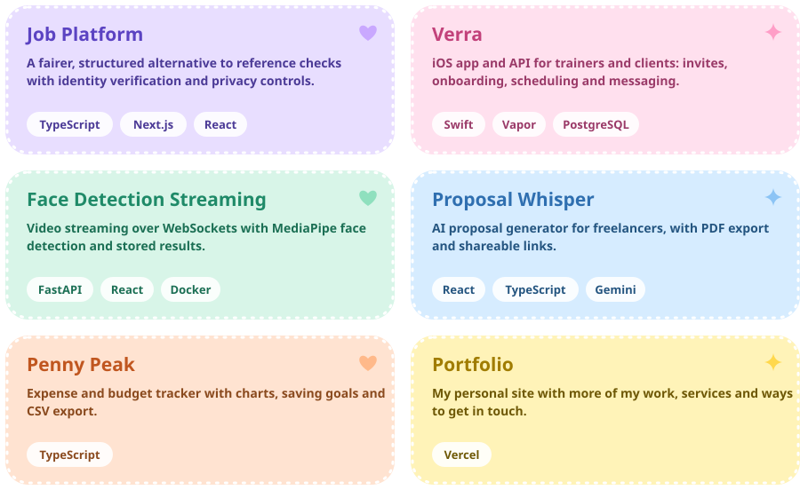

 

  

 

## 🌷 About me

Hello, and welcome to my little corner of GitHub! ✨

I'm a **Senior Software Engineer** from Lahore, Pakistan 🇵🇰 with 5+ years of experience building and scaling production SaaS applications. I work across the whole product: database, API, CRM and third-party integrations, payments, AI features, automation workflows and deployment. I love clean, test-driven code and turning business needs into scalable solutions, from MVP to scale.

- 💻 Building with **Ruby on Rails, React, Next.js, Python and FastAPI**
- 🔌 Connecting **HubSpot, Monday.com, LeafLink, QuickBooks** and more
- 🤖 Building **AI agents and automation** with Pipedream and Zapier
- ☁️ Shipping to production on **AWS and Heroku**
- 💌 Open to **remote contracts and long-term roles**, so say hi!

 

## 🧁 My toolbox

 

## 💼 Where I've worked

🎓 **Bachelor of Information Technology**, Punjab University, Pakistan (graduated May 2022)

 

## 🎀 Products I've built

 

Also: **Nyxion.ai** (email marketing on AWS SES), an **HR and attendance platform**, **Guides and Hides** (Airbnb-style hunting hides), the **Teleco.io API**, and a low-code **ERP** demo.

### 🔁 Automations and AI

- **LeafLink → HubSpot:** keeps CRM records and leads in sync without manual entry
- **QuickBooks → Google Drive:** files documents automatically, cutting admin work
- **Multi-agent AI system:** specialized agents that reason and act together, including a health-app chatbot

 

## 🧸 Open-source and side projects

[Job Platform](https://github.com/AqsaAltaf1/Job-platform) · [Verra](https://github.com/AqsaAltaf1/Verra-fitnessapp) · [Face Detection Streaming](https://github.com/AqsaAltaf1/Real-Time-Face-Detection-Video-Streaming-System) · [Proposal Whisper](https://github.com/AqsaAltaf1/proposal-whisper) · [Penny Peak](https://github.com/AqsaAltaf1/penny-peak) · [Portfolio](https://aqsaaltaf.vercel.app/)

 

### 💌 Let's build something lovely together

[Portfolio](https://aqsaaltaf.vercel.app/) · [LinkedIn](https://www.linkedin.com/in/aqsa-altaf-295416201/) · [Email](mailto:aqsaaltaf01@gmail.com)

Made with 💖 and a lot of ☕

